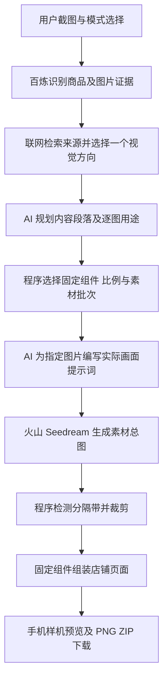

# 店铺装修推荐项目目标与架构交接

更新日期：2026-10-19。面向接手开发、排障或方案讨论的 agent。

## 当前：珠宝 v21 原生组件与可上传图文素材

- 初稿预算阻断修复：同一任务第三次content已收到15张超预算反馈，却仍返回14张。原流程在整套修订前要求初稿符合最终预算，导致无法利用既有修订。现仅v21完整但超预算的初稿作为reviewDraft进入原有一次design，传完整初稿、各模块图数、上限12及至少减少数量；不生成或保存可执行的结构计划。终稿编译仍严格限制12张/两批，未自动删模块、提高预算或增加重试轮次。用户继续可直接复用这份14张初稿进入修订；已存原始响应不改。必要检查仅实际响应的初稿/终稿入口及语法，未调用模型、生图或模拟流程。
- 品类/款式引用修复：`503ba7f6-826a-42e4-89e5-0c4255b367ad` 第二次content把结尾海报的design-1/2/3写进evidenceIds。仅v21模型入口兼容该格式，编译时按本图已声明款式的collection.category唯一对应product-*；不替换前缀、不从描述猜品类，未知/非本图/歧义引用仍拒绝。该实际响应另有15张图，保留12张预算，未删改模块；用户继续时把缓存编译的具体错误交给原有规划调用，避免无反馈重新请求。未改保存响应，未调用模型或生图；已做语法和该响应只读编译检查，下一步由用户继续生成验收。
- 招牌空引用修复：`503ba7f6-826a-42e4-89e5-0c4255b367ad` 的经典招牌明确是无商品光影背景，两组引用均为[]，旧商品图契约错误拦截。仅默认/经典招牌背景允许无商品引用，两组必须同时空或同时有值；正文仍须真实引用。方案层和最终生成提示同步支持空款式，不填造商品编号、不让背景增加商品。该响应另有3张组合海报写了文案但placement=none，已补强提示；不猜位置或丢字，用户继续时复用识别重新请求创作。未修改保存响应、未替用户调用模型或生图。
- 招牌修正：用户明确招牌必备，并要求除全屏轮播外全部纳入设计。v21 由 AI 在默认 `signboard.default`、经典 `signboard.classic`、极简 `signboard.minimal` 中选一种，唯一且首位；禁止 `signboard.fullscreen`。默认/经典背景参与原有生图、裁剪和素材下载，计入12图/两批，经典使用新增精确比例483:224；下方36%留给原生店铺信息，设计字只允许顶部。招牌背景使用独立identity-bg，正文overview仍是全页主视觉。模型漏写招牌时补无图极简，已有招牌排到首位。当前任务 `458c7585-6534-4c34-aa0d-1d36f2f788be` 已复用原图补齐极简招牌；新任务才会按整体方案选用三种样式，未替用户生图。
- v21 格式修复：任务 `458c7585-6534-4c34-aa0d-1d36f2f788be` 把 `copy.tone` 返回为 dramatic/poetic/空字符串；提示遗漏 tone 的枚举说明。`storefront-contract.cjs` 已明确 base/alternate 是配色选择，模型响应入口对其他字符串沿用既有 base 默认值，不按情绪词猜配色，不放宽最终 artwork 格式。保存的实际响应已通过只读编译（4模块、11图、2批），无需重传商品图；用户继续时可复用初稿进入修订。没有模型调用或生图验证。
- 开发前 v20 已成功推送到 `codex/jewelry-still-life`，提交 `9f6e10b`。本轮依据用户对 `e6113bfc-8158-48a5-a316-60ca161d21c1` 的反馈：保留叙事效果，但素材必须能用于真实装修，设计文字须在图片内，模块外始终白底。没有重新推送或合并本轮修改。
- 仅新建珠宝任务启用 `pageComposition=platform-slots-v1`，编译后保存 `plan.delivery` 同名标记。`storefront-contract.cjs` / `storefront-plan.cjs` 直接给 AI 现有组件名、图片数量及真实槽位尺寸。AI 决定章节、组件选择、顺序和每图作用，程序不再从自由布局/图数推导组件。支持现有海报、组合海报、轮播、橱窗、导航及三种非全屏招牌；独立网页图文块、图外设计标题和全页染色不再用于新版本。
- 保留经营方向、系列款式、人物与静物变化、共同摄影参考、一次创作与一次修订、12图/两批及原裁剪检测。`pageDesign` 仅供图片内部图文风格使用。模块的 `narrative` 是内部章节信息，不额外画到网页上；原生商品标题/导航标签仍按实际组件显示和导出。
- `slot-artwork.cjs` 按模型指定的 copy 文案、位置、色调和实际槽位排字，安全区同步进入逐格生图提示。裁剪后使用现有 sharp 合成设计文字到 `assets/*.png`，照片原裁片另保存在 `source-assets`，不增加模型调用。整批成功准备后才写成品；续跑从原总图裁剪，不在已有文字上重复叠字。排字长度超出可读空间时在规划阶段提示，不能把文字挪到图外或截断。
- 新版预览由原冻结组件库渲染，沿用原白底、尺寸、间距与控件；下载直接打包同一批成品PNG，一个文件对应一个真实槽位，不再将整段橱窗截图当作全宽海报。ZIP提供组件类型、顺序、槽位尺寸和原生名称字段。长图只用于查看/分享，即使回退为不含长图的下载，PNG中的设计文字仍完整。
- 已有 v20/更早任务按保存的方案和规则继续，其他模式及5185逐图分支不变。必要检查为语法、模块依赖、已有 v20 方案兼容与代码差异；未调用AI、未生图、未执行模拟流程或渲染/截图验证。需用户新建珠宝任务验收，并将下载PNG用于对应平台组件核对实际效果；原生标题、商品绑定和价格仍由平台真实商品数据决定，不能承诺未知平台版本的每个像素完全相同。

## 珠宝 v20 章节叙事与图文编排

- 开发前 v19 已提交并成功推送至 `codex/jewelry-still-life`，提交 `38560d8`；v20 后续已保存并推送为 `9f6e10b`。没有合并或标签。
- 用户希望在视觉一致性下形成类似品牌官网的产品叙事。依据其任务 `1a4f4fa9-efff-4380-9d4e-9160bbaed7aa` 的已存创作数据及编译器：旧模型已经写 narrative/purpose，但固定首图加正文方图、最多两个标题、按图片数决定组件，使内容意图未完整落到成品。参考 Xiaomi 15 Ultra 官方页面的主题、外观、使用场景、细节层次：https://www.mi.com/global/product/xiaomi-15-ultra/ 。不声称本轮已达到官网视觉质量。
- 新珠宝 profile `version:20,pageComposition:narrative-v1`。`narrative-contract.cjs` 定义新的 content：narrative/reason、共同摄影 reference、pageDesign、collection、按阅读顺序的 modules。AI 决定3至10个模块的章节、message、衔接、标题短文、数量、布局、比例与明暗；支持 poster/editorial/pair/collection/statement，不再要求固定首图+sections，不再按图数替AI选模块或删除第三个标题。仍最多12张、两批，沿用识别→一次创作→一次修订，无新增模型调用。
- `narrative-plan.cjs` 只检查字段、引用、图片数与预算，编译模型选择；不推断产品卖点或审美。`narrative-layout.cjs` 确定像素、换行及安全绘制：整页共用配色/字体；标题可以在图片上排字，图片生成时预留对应区域。文字不让生图模型重画，宽幅内放不下时完整移到图下并同步生图布局说明。用户输入/模型文案均转义，离线HTML无外部资源。
- 最终生图 prompt 除 v19 的同一摄影基准、款式外观和全局style，还实际包含全页章节顺序、每图message/衔接/排字位置及邻接背景色，避免只有总述有叙事而逐图只拍商品。`plan.pageDesign` 和 `modules[].story` 标记新渲染；旧任务和其他模式继续使用原组件库。
- `compose.cjs` 按保存的方案选择渲染器，保持原预览尺寸、裁剪与任务恢复接口。正常下载在原有一次长图导出后按同一几何切出“模块成品”PNG，含已排好的字；ZIP同时保留原素材、文字、章节映射及离线HTML。仅原始素材的回退下载仍可用。新模块不依赖微购相同组件，成品可按顺序作为全宽图片上传。
- 已做必要语法/模块依赖检查，旧 v19 plan 兼容检查；用用户已存文字及引用在内存检查五种布局的数据贯通、两批限制、共同参考、文字转义、长文案保留和导出尺寸。未调用任何AI、未生图、未浏览器渲染/截图、未改写旧任务产物。最终叙事与视觉效果由用户新建珠宝任务验收。

## 珠宝 v19 全页视觉一致性

- 开发前已将完整 v18 与「呈境」简洁界面保存并推送到 `codex/jewelry-still-life`，提交 `d27e00c`（GitHub 推送明确成功，无合并）。该提交是此次调整前的回退点。
- 依据用户成品 `0f4cdd82-78ae-41ee-b661-3c6802b67715` 的原总图与实际请求：五格分别使用帷幕、岩石、白墙、霓虹和丝绒；v18 方案中的全局 style/anchors 未进入最终珠宝生图正文，各格案例各自控制画面。另有 `design-*` 款式编号进入提示词，但 collection 外观未传给生图。上述是已读取到的事实，不是新生图实验。
- 仅新建珠宝任务使用 v19，保留既有识别→整页创作→一次修订→总图裁剪流程和模型次数。创作先确定同一摄影世界、调色、光质与材质语言，再通过款式、人物、景别、尺度及疏密形成强弱变化；修订同时检查连续性与亮点，避免全页素底或不同风格拼贴。
- 沿用既有模型字段：AI 为首图选定的 `heroVisualPlan.visualReference` 同时作为全套摄影基准，保存在 `plan.campaign.reference`，每批始终附带同一参考像素并标记 `campaign-identity-v1`。全局 `style`、`artDirection` 实际写入最终请求；其他逐图参考降为姿态/构图辅助。上一批成图辅助对齐实际质感，不替换固定基准。
- `plan.campaign.collection` 与每图 `designIds` 由已有创作数据直接传递，程序按编号把实际入画款式描述写入该格，不改写商品或替 AI 做语义分类。未增加模型必填字段、额外生成母图、视觉打分、自动重试或付费验证。
- v18 及更早任务继续使用保存的规则和旧生图分支；通用、数码、鞋履暂不迁移，界面、裁剪、组件及导出不变。新规则需新建珠宝任务体验，不能通过继续旧任务获得。
- 本轮仅必要静态语法、模块依赖与差异检查；没有模型调用、生图或模拟视觉测试。是否达成「同一店铺的丰富画面」仍待用户实际生成验收，不把字段传递正确当作视觉质量已验证。

## 珠宝 v18 创作响应结构损坏与说明字段修复

- 任务 `13568a23-f297-428b-a7f9-1388bf4b6498` 第3次识别已完成，停在首次 content。报错首先指向 revisionSummary，但原始响应的 collection、visualReference、sections 同时包含大量冒号/逗号字段名和缺失内容，不能只补一句修订说明后沿用；接口为 stop、1878输出tokens，并非10000 tokens上限截断。
- 修订说明仅用于界面展示，改为可选，不再阻断有效方案；不编造说明，款式、图片、引用及预算仍由原校验完整检查。此修复不会使当前损坏的正文通过。
- 仅珠宝 campaign 的 content/design 两个调用改为普通输出按提示返回JSON，不发送 response_format=json_object；原有 JSON 解析、有限引号转义兼容和业务校验保留。调用设置保存 outputMode=prompt-json。识别、其他模式、模型、图片、采样、调用次数及重试策略不变。不能据此认定 JSON Mode 是唯一根因；这是针对已观察结构损坏的输出路径调整，稳定性待用户续跑确认。
- 用户手动继续时复用成功识别，重新请求创作；未改保存的响应、未替用户继续、未调用模型或模拟测试。仅必要静态检查及服务重启。官方能力说明：https://help.aliyun.com/zh/model-studio/qwen-structured-output 。

## 珠宝 v18 识别响应提前结束的请求修正

- 同一任务 `13568a23-f297-428b-a7f9-1388bf4b6498` 的第2次识别只写完前三组，第4组 products 只有字符串 `":{"`，且缺少经营摘要等顶层字段。接口 HTTP 200、finishReason=stop、output_tokens=346，不是程序因达到10000 tokens上限截断；现有响应无法补出缺失资料。
- 仅 v18 识别请求改为精简的实际字段填写契约，去掉重复 JSON Schema 和错误结构示例；单独设置 temperature=0.1，保存该次 settings。其他识别模式、创作/修订、生图参数、完整性校验、调用次数与手动继续流程不变；不填造或跳过坏商品，不自动重试。
- 官方 JSON Object 模式不保证字段结构，不能把接口返回 stop 当作业务内容完整。参考 https://help.aliyun.com/zh/model-studio/qwen-structured-output 。这些调整用于降低格式失误，实际稳定性待用户继续任务确认，未调用模型、生图或做模拟测试。

## 珠宝 v18 识别分类重复定义修复

- 任务 `13568a23-f297-428b-a7f9-1388bf4b6498` 的识别响应在 `groups` 定义4组，在 `businessScope.categories` 却改名并合并为3组，导致一一对应检查停止；尚未进行创作或生图。
- 新识别契约把 `businessTraits` 放进每个商品分组，与商品共用唯一 `name`；顶层 `businessScope` 只输出 summary/freedom/avoid。程序按原分组名称归一化后保存兼容下游的经营资料，不猜同义词、不拆分合并类别、不改写特征。已保存且有效的旧经营资料仍可复用。
- 此格式修复也适用于手动继续的 v18 任务，不改保存的创意规则、其他模式或后续流程。本次不一致响应不能可靠补全；由用户点击“沿用已有资料继续”，保留原截图重新识别，无须重新上传。仅必要静态检查，没有模型调用、生图或模拟测试。

## 当前：珠宝 v18 整页创作与一次修订

- 只对新建珠宝任务启用 `creativeWorkflow=jewelry-campaign-v1`。旧任务使用已保存快照；通用、数码、鞋履、5185逐图分支不迁移。保留现用模型、12张/两批预算、总图分隔与裁剪、预览和导出。
- `campaign-contract.cjs` 保存新流程契约及精简创作方法。正常语言模型调用从5次调整为3次：识别并提炼经营边界 → 看真实案例统一创作 → 看同一组案例进行一次整套修订。不再运行搜索标题与独立风格调用；不追加自动评审循环或重试。
- 原商品逐件观察仍保存于 `recognition.json`；新增 `businessScope` 由识别AI提炼经营类型、代表性外观、可变化范围和边界。后续只接收这份经营摘要，每品类一个 `product-*` 资料编号，不传原SKU描述或原商品图。程序只做字段、编号和分类对应检查，不用关键词选款或过滤审美。
- 创作与修订直接接收两份整页案例和五份摄影案例，其中新增用户案例中的成年人物人像、颈部佩戴；来源和裁切坐标在 `visual-references/manifest.json`。完整页面仅用于规划，生成阶段只附各格选中的摄影案例与原有上一批总图。新流程允许并要求安排成年人物佩戴，不继承旧珠宝静物禁令。
- `campaign-workflow.cjs` 输出完整 `collection` 款式目录、每图 `designIds` 与最终 `picture` 提示词。审稿可修改整套款式、图数、顺序、参考和构图，终稿重新映射现有组件；`picture` 直接进入生图，不再由下游扩写或锁定初稿创意。生成端标记 `campaign-reference-v1`，人物/静物各按本格计划执行，不全套套用一份背景。
- 方法根据已有 EC Visual 的 visual-dna、message-picture-patterns 精简适配；新流程不继续叠加旧模式的多轮指令和整份原文。页面展示经营边界、设计款式及修订说明，不声称执行了联网检索。
- 初稿/终稿另存 `creative-draft.json` / `creative-final.json`。调用记录仍用 recognition/content/design；手动继续时复用已完成阶段，修订缓存须匹配完整初稿、经营边界和规则快照。复用不增加自动调用。
- 已完成必要静态语法、模块加载、JSON及差异检查；没有调用模型、生图或运行模拟测试。视觉收益尚未验证，由用户新建珠宝任务验收：不同款式是否增加、人物是否进入画面、整页是否出现真实的强弱与场景变化。旧任务继续不会使用 v18。

## 珠宝 v17 内容字段别名兼容修复

- 任务 `f8a3655b-ce13-46ca-be66-73669b61b1cc` 在内容阶段停止，尚未生图。原响应首图字段正确，正文完整画面却写在 `visualPlan.description`，参考说明使用 `Borrow/Avoid`，与契约的 `picture/borrow/avoid` 不一致。
- 仅在 `page-direction.cjs` 的新整页内容 schema 入口兼容这三个已观察到的别名；标准字段缺省时才取别名，原类型、非空、长度、引用与预算检查保留，不填造设计、不截断文字、不修改已保存响应或其他模式。输出提示明确正文和首图使用相同字段名。
- 原有“沿用已有资料继续”会重新读取并解析保存的内容响应，修复后可沿用它进入画面设计。未替用户续跑、调用模型、生图或执行模拟测试。

## 珠宝 v17：整页创意贯通到实际生图

- 用户授权落实整页方案，继续禁止代理生图/模拟测试。本轮只处理珠宝整页规划及提示词传递；其他模式、旧任务快照、5185分支不迁移。模型、调用次数、12张/两批预算、总图分格与裁剪不变。
- `9d5aec46-3ab7-4c77-80eb-53f2f5c908a8` 已由用户续跑完成。实际内容安排是三款主体加背扣和旧款合照；此前内容阶段没有案例图片，相邻单图又被自动并列。款式数量不是整页视觉变化的替代，不能只继续追加新款规则。
- 选用已有 `珠宝案例/huaban-6542776564.webp` 完整长页，借鉴大场景与小图、左右主次、明暗疏密；不复制原商品、红色、促销或表单。单图沿用两张伯爵静物并补该长页的静物区域，来源及用途在 `visual-references/manifest.json`。完整页面只进入风格/内容规划，不送给火山；生成只收各图选定的摄影参考。
- `page-direction.cjs` 保存新规则及内容字段契约。新珠宝 v17 的现有内容调用直接接收页面和单图像素，输出 `pageDirection`、`heroVisualPlan`、各图 `visualPlan`（picture、difference、visualReference）。经营方向与商品资料引用不变，允许范围内的新款；程序只检查结构、引用、数量和几何，不筛选审美或语义。
- 主视觉比例由内容规划在已有三种轮播组件中选择；正文保留规划的单图/双图/三图与 focus/equal 主次，相邻单图不再自动合并。组件几何与裁剪算法未改。正文三图用现有海报组件，避免为了浏览而扩展重复橱窗。
- 逐图设计接收完整画面安排及显示尺寸，只落实摄影指令；主视觉/正文参考ID及 borrow/avoid 直接从内容方案传到生图，不由后续阶段重选。导航仍按已有中央安全区设计并选参考。新快照 `backgroundGuidance=planned-reference-v1` 使最终请求按各格已定场景和参考用途执行，不将整张参考背景强加到每格。
- 内容方案和每图安排可在原“查看整页内容规划”中查看；缓存签名包含完整创意，避免相同组件误用另一份设计。无新增审批、评分、自动重试或额外模型调用；视觉效果待用户新建珠宝任务测试，旧任务不会自动重画。

## 风格阶段返回格式定义的修复

- 任务 `9d5aec46-3ab7-4c77-80eb-53f2f5c908a8` 的风格响应只有 `$schema/type/properties` 等字段定义，没有实际主题、理由或色板；接口正常完成，尚未生图，不能从这份响应恢复设计内容。
- 风格请求沿用画面设计阶段的处理方式：移除作为输出示例的 JSON Schema，改为实际字段填写要求，并放在已保存的模式规则之后。`validateResearch` 对返回格式定义的情况给出明确原因，正常风格校验与来源约束不变。
- 当前任务可由用户点击“沿用已有资料继续”，复用已有识别和检索，从风格阶段重新请求。没有替用户续跑、自动重试、填造方案或修改原任务文件；只做必要静态检查及服务启动，未调用模型、生图或模拟测试。

## 珠宝 v16：替换款式重复的冲突提示

- v15 实测任务 `15449d2a-3bd9-4ca5-82d5-68654d070905` 的7张图仍围绕4种造型，两枚戒指占其中5张。内容响应把 A、B、A+B 合照称为“三款”，重复在生图前已产生。v15 已生效，但共用提示仍要求列举“所引商品的可见特征”、允许同款补充信息，新句“不同款式或不同组合”也未排除旧款组合。
- 仅新建珠宝 v16 选择 `visual-method.cjs` 的系列规划版本，替换旧内容/设计句子；其他模式继续原共用文字。原内容调用先在 `reason` 简列实际不同款式，再写各图主体；普通商品画面要引入新款，角度、背景、放大或旧款合照均不算新款。必要 detail 明确其对应款及独立信息，没有新内容则在原段数与品类覆盖范围内减图。
- 珠宝内容阶段的 skill 适配同步改为“经营特征约束下的新外观设计”，不要求每处装饰都在原图中找到。设计阶段不再假设上游已完成款式差异，按已有图片任务核对并细化主体差异。经营方向、真实属性边界、背景参考、字段与校验、模型和调用次数、排版及裁剪不变；旧任务保持原快照。
- 只做必要静态检查和服务启动，不进行模型调用、生图或模拟测试。是否减少重复须由用户新建珠宝任务验收，不能把提示词修改视为视觉效果已经验证。

## 珠宝 v15：经营特征与具体款式分开

- 用户认可 v14 的背景方向，但任务 `d93befb0-e3ee-4a79-a398-3c190b10e9e9` 的6张素材围绕4个来源造型展开，其中3张为局部特写。内容方案在生图前已重复指定这些造型；这证明本次款式单一已存在于规划，不代表模型无法创作其他款式。
- 仅新建珠宝任务升级 v15。沿用现有内容规划调用，在原 `reason` 概括应保留的经营特征与可变化的款式要素，在 `heroSubject` / `subject` 具体设计系列款式；优先用不同款式和组合展开，局部图按信息需要选择，不固定每个原款的整体加特写。
- `heroEvidenceIds` / `evidenceIds` 仍引用真实资料编号，关联实际入画的品类和经营特征，允许同一资料支持不同示意款式。仅修改模型提示中的引用含义、主视觉编号的 schema 描述与设计输入 `evidenceScope`；程序的编号存在性、品类覆盖、数量、尺寸及裁剪校验不变，不进行程序化选款或新增语义拦截。
- 画面设计落实内容规划的款式差异，不按引用编号退回原款。保留 v14 参考图背景规则、经营方向与静物边界；其他模式及旧珠宝任务不升级，模型、调用次数、页面与素材流程不变。必要静态检查及服务启动后交付，不生图、不模拟测试，视觉效果由用户新建任务验收。

## 参考背景与文字要求的优先关系

- 当前新任务：通用 v4、珠宝 v14、数码 v6、鞋履 v5，新增快照标记 `visualSkill.backgroundGuidance=reference-background-v1`，仅这些新任务使用本轮规则；已有任务仍使用原快照及生图提示路径。
- 用户任务 `9db48ffc-17e2-4f61-82d9-dd1a422504bb` 的请求记录确认案例已送入火山，原始总图中已出现冷暗背景问题。风格与逐图提示把案例的大面积暖亮表面、渐变压成了全套深暗背景、冷硬光和哑光台面，最终提示又重复这些全局 anchors。上一批总图可能进一步放大此倾向，但其独立影响未经验证。
- 在现有风格/画面设计调用内，把案例的亮暗面积、过渡、纹理与阴影/倒影落实到原有 `reason`、`prompt`、`visualReference.borrow` 字段。允许沿用合适的背景色，换色仍保留视觉关系；不复制案例商品、品牌、文字或无关道具，不改变经营方向。
- 新批次不再向最终生图提示重复注入全局 anchors / palette；它们仍供画面设计使用并保存在方案中，由 AI 落实到每图。生图端明确背景关系按本格指定案例和借鉴说明优先，上一批总图只辅助商品本色和表面表现。程序不做语义筛选，不新增模型调用、图片、字段校验关卡或重试。
- 商品截图用途、模型、调用数量、预算、排版、总图几何与裁剪保持原路径。只做必要语法与差异检查及服务启动；不调用模型、不生图、不模拟验证，效果待用户新建任务验收。

## 精选案例直接进入火山生图

- 新任务：通用 v3、珠宝 v13、数码 v5、鞋履 v4，快照新增 `visualSkill.generationReferences=visual-reference-v1`。旧任务不增加生图参考，也不要求新增字段。
- 珠宝采用已查看的伯爵官网 Possession / Piaget Rose 静物图；数码采用用户案例中的小米、realme宣传图；鞋履采用用户设计案例的主鞋/成对画面。`visual-references/manifest.json` 记录出处、裁切区域与借鉴范围；小米来源不能冒称已核实的淘宝店，鞋履不能冒称品牌官网。新参考尽量裁去广告文字和页面控件；图片版权仍属原权利人，不属skill的MIT授权。
- 风格与画面设计调用都接收参考图片。画面AI为每项返回 `visualReference={id,borrow,avoid}`；程序只校验结构和本任务编号，按批次/行/格传递，不判断审美、不猜选图、不添加模型调用。商品截图仍用于经营及外观边界，未发送给火山作为案例。
- `ark-image-provider.cjs` 将本批选中的案例实际放入 `image` 字段，后续批次仍附上一批总图，提示词明确各附件用途。官方接口支持 string/string[]，Seedream 5 Pro最多10张；当前每批最多3张案例+1张上一批总图，仍只生成一张总图，未开启组图。依据：https://www.volcengine.com/docs/82379/1541523 。
- 发送前将实际案例JPEG保存在任务根目录 `visual-reference-*.jpg`，请求的 `batch-*-attempt-*-settings.json` 记录参考ID、附件序号、用途、来源及上一批附件编号；最终 `*-prompt.txt` 为实际发送文本。参考不替换导出素材。排版、预算、分格与裁剪不变，无自动重试。
- 只做必要静态检查及服务启动，不调用模型、不生图、不模拟请求；效果由用户新建任务验收。直接附参考属于本项目对接方式，不能声称上游skill明确强制了某种API传图方式。

## 固定 skill 原文与实际案例图片接入

- 新任务版本：通用 v2、珠宝 v12、数码 v4、鞋履 v3。`visual-skill.cjs` 将 EC Visual 固定提交 `fead6fa34679a920ed67c7119e2df526ed2d139c` 的原文按阶段送进既有风格、内容、画面设计调用，不再只使用摘要；来源与MIT许可保存在 `planning/skills/ec-visual/`。不执行上游固定15图、审批、逐图生成、文字生图或自动评审重试工作流。
- 风格调用实际附带 `planning/visual-references/` 的用户案例图片（每模式2张，通用3张；长页只取顶部主视觉），借鉴主体尺度、光色反差与空间关系。案例不是商品证据，不决定经营品类或替换商品；搜索仍只取得标题与网址。每次调用的 `style-*-input.json` / `style-input.json` 记录文档原文、版本、参考ID与附件顺序，`style-research.json` 记录参考来源。
- `research.reason` 保存从案例提取的吸引点，内容阶段沿用现有字段表达“画面是什么、无文字能看懂什么”，画面阶段落实主体如何比环境醒目。原图的桌面、草地、包装不自动成为布景。案例图只传给风格规划模型，未直接传给火山生图模型；生图仍接收原有总图提示词与后续批次风格参考。
- `visualSkill` 与阶段适配文字保存到新任务规则快照。旧任务不升级，模型与调用次数、识别和商品引用、组件、素材预算、分格裁剪和导出保持原流程。仅静态必要检查，无模型调用、生图或模拟测试；新效果由用户新建任务验收。

## 公共方法迁移到其余模式

- 新建珠宝 v11、鞋履 v2、通用 v1 与数码 v3 共用 `product-visual-v1`：简洁店招、4:3 主视觉、相邻正文单图并列、实际显示尺寸与信息用途传递、风格/内容/画面设计分工，以及精简总图提示词。没有增加模型调用或验证关卡。
- 珠宝继续传递完整识别文字及逐图证据、不附原图，保留 `heroEvidenceIds` 和主视觉加正文的品类覆盖口径；其他模式仍附原图、使用原商品引用及正文覆盖。鞋履保留左右脚、鞋型和可见结构要求；通用保留按商品选择表达方式，不继承专业模式的禁人物限制或特定商品部件。
- 新通用任务也保存规则快照，旧通用任务没有 `visualProfile` 时仍走原流程；所有旧模式任务使用保存的规则，不静默升级。界面只补齐通用规则的正确名称；现有操作、模型、裁剪与导出流程不变。
- 仅必要语法与差异检查，不调用模型、不进行生图或模拟测试。生图效果由用户新建对应模式的任务验收，旧预览保持原结果。

## 数码 v3：共用设计方法与页面编排

- 数码 v2 任务 `778b23b1-1165-4d5d-b57f-44f1453796e1` 已完成，但用户认为效果差。只读记录显示：空白氛围店招、3:1 主图、连续单张正文；风格锁定灰底柔光，5张商品图的设计提示词照抄内容描述。这个结果说明迁移提示词并不等于迁移有效方法，不能用流程成功证明视觉收益。
- 新数码任务使用 v3，保存 `visualMethod=product-visual-v1`。`visual-method.cjs` 集中维护可跨品类复用的风格、内容、画面设计分工，保存到任务的仍是完整规则文字。内容阶段分配信息用途，画面阶段结合程序透传的 `tasks.intent` 与实际 `display` 尺寸决定取景和布景；可在本次设计中纠正上游将背景、光位误当共享约束的问题，不增加模型请求、语义过滤器、评分或重试。
- 页面编排通过独立的 `usesProductPageLayout` 开关复用原珠宝逻辑：数码使用简洁店招、4:3 主图，相邻单图并列，保留每张图的编号与用途。`usesCategoryReference` / `usesProductContext` 未扩大，数码识别、原图传递、商品引用与正文品类覆盖保持原口径，未新增 `heroEvidenceIds`。
- 本轮只启用新数码任务；珠宝 v10、通用、鞋履及已保存数码 v1/v2 继续原规则。模型、总图分格、分隔带、裁剪、下载及5185逐图分支未改。仅必要语法与差异检查，不进行生图或模拟测试；用户需新建数码任务验收，旧预览不会自动重做。

## 数码 v2：迁移画面规划方法

- 5184 新建数码任务使用 v2：从商品可见特点确定主题，首图建立形状或空间关系，正文补充整体、组合或有依据的局部信息；全套共享色彩与质感，各图按用途选择背景和光位。保留广泛数码品类支持，不新增白名单或模式适用性判断。
- 沿用数码原字段、商品识别及原图输入路径、正文品类覆盖和组件比例选择，不套用珠宝的 `heroEvidenceIds` 或固定4:3。最终总图请求复用精简提示词路径，附简短的数码外观、部件与屏幕约束；分格、洋红分隔带、裁剪、模型及调用次数不变。
- 珠宝 v10、其他模式和已保存的数码 v1 任务保留原规则，5185 逐图分支不处理。仅作必要语法与差异检查，未进行生图或模拟测试；迁移效果由用户新建数码任务验收。

## 本次微调：裁剪版珠宝 v10

- 基准为已推送的 `09a27eb`。用户已完成 v9 任务 `55daa2cf-1eec-4b15-9cf2-80463b359196` 的裁剪恢复，5张素材齐全，总生图调用仍为1次，并认可整页效果；该结果不代表多次生成的稳定性已验证。
- v10 仅微调内容规划与画面设计提示词：首图把商品特点转成明确的形状或空间关系；正文重复展示同类或同款时补充前图未看清的信息；局部图突出有依据的具体部位。沿用原风格选择，不强制换款、换背景或微距，不增加字段、模型调用、素材或审核步骤。
- 仅新建珠宝任务使用 v10，旧任务保留原规则。模型、总图分格、裁剪、组件与其他模式不变，5185 逐图分支不处理。本轮仅必要语法与差异检查，不生图、不模拟测试；效果由用户验收。

## 已交付基准：裁剪版珠宝 v9

- 5184 的新建珠宝任务已同步逐图分支的 v9 规划方法：先确定各图可见信息，再设计场景与构图；全套共享色彩、反差和质感，不固定为同一背景与光位。仍根据完整识别资料理解经营方向，允许创作范围内的新款式，不锁原 SKU。
- 方法来源为 `oldred-byte/ec-visual-skill` 的 [visual-dna](https://github.com/oldred-byte/ec-visual-skill/blob/main/references/visual-dna.md) 和 [message-picture-patterns](https://github.com/oldred-byte/ec-visual-skill/blob/main/references/message-picture-patterns.md)。总图请求仅保留本批逐格描述、共享视觉语言与必要分格规格，不再叠加整页叙事及全部专业规则。
- 原素材数量、批次、行列比例、洋红分隔带、裁剪、组装、下载及模型调用方式保持原路径。仅新建珠宝任务使用 v9；已保存的任务、通用、数码和鞋履规则不升级。5185 逐图分支本轮未修改。
- 仅作修改文件的语法与差异检查，没有生图或模拟测试，视觉效果交给用户验收。下文 v8 描述保留为历史背景。

裁剪修复记录：任务 `55daa2cf-1eec-4b15-9cf2-80463b359196` 的已保存总图具有3行5格，但分隔带约为 RGB(213, 1, 111)，且缺少完整外框，标准洋红检测及原外框校准无法识别。`crop.cjs` 在原行检测失败时补充窄幅、贯穿全宽的内部分隔带校准；要求横带数及检测出的全部行列数符合方案，只将与图像外围连通的匹配颜色作为分隔，避免内部宝石被当作分隔带。不按预计比例猜切，不改生图或自动重试。用户可通过“继续未完成素材”复用已保存总图；本轮未执行裁剪恢复、生图或模拟测试。

本项目帮助不懂店铺装修的用户，把商品截图转成一套可预览、可下载的店铺装修方案。当前主线采用 **AI 理解商品与设计图片，程序选择固定组件、裁剪图片并组装页面** 的分工。新珠宝 v8 任务向后续 AI 传递完整识别资料，由 AI 判断实际经营商品类型并创作新款式，不要求复刻原 SKU；其他模式与旧任务沿用原规则。

## 当前工作位置

| 项目 | 当前约定 |
| --- | --- |
| 实际开发与运行的工作副本 | `H:\Codex\jewelry-still-life\店铺装修推荐` |
| 当前分支 | `codex/jewelry-still-life` |
| 主线代码目录 | `experiments/store-decoration/planning/`，下文简称 `planning/` |
| 本机页面 | `http://127.0.0.1:5184/` |
| 本机任务目录 | `planning/output/runs/<任务ID>/` |

会话的默认目录可能显示为 `H:\店铺装修推荐`，但近期修改和 5184 服务使用的是上表中的工作副本。动手前先核对工作目录和分支。当前副本已有未提交的功能修改，不要重置、覆盖或误当作本轮新增变更。

仓库同时保留早期应用和多轮实验。根目录的 Vinext/React 工程、`server/`、`scripts/decoration-assisted/` 及历史验证脚本不是当前 5184 页面入口。根 README 中部分“当前版本”“尚未实现”等文字属于当时的历史记录，不能直接作为当前功能判断。

## 产品目标与已确认边界

- 用户上传 1 至 6 张商品图片或商品列表截图，选择通用、珠宝、数码或鞋履模式，一轮得到一套方案，不要求比较多个候选风格。
- 展示清楚的整店效果，同时提供完整 PNG 长图和可按模块取用的素材 ZIP。ZIP 用于手动装修，不是平台一键导入包，也没有自动发布能力。
- 珠宝 v8 保留识别出的商品描述、来源与不确定信息，由 AI 判断哪些特征代表经营方向，允许在这个范围内设计新款式。v5–v7 的“只传大类名”仅保留给旧任务；不静默升级旧任务或改变其他模式。
- 固定组件承载店招、导航、海报、轮播、橱窗与文字。生图模型只画素材，不画网页控件、价格、标题或平台 UI。
- 不虚构经营品类、真实商品材料、品牌、销量、认证或功能；示意外观属于设计选择，识别中的视觉描述及推测也不是材质、价值或定位证明。信息不足与模式适用性是两回事：保留原有信息充足性判断，不增加品类白名单或专业模式准入判断。

当前珠宝质量目标是：生成商品仍符合实际经营方向，一个有明确构思的主视觉，整套协调且有强弱变化，完整覆盖经营品类。上传图用于理解商品类型，不要求逐件复刻原款。流程完成不能直接证明这些视觉目标已经达到。

## 主流程与职责边界



一次正常任务包含五次语言或视觉模型请求：商品识别、联网检索、风格选择、内容规划、逐图设计。生图最多两批，每批生成一张含多个独立画面的总图；不要求用满预算。

**AI 决定内容，程序决定几何。** AI 先说明展示哪些商品、各图用途与主次；程序据此选择现有组件、绑定素材编号、确定比例及分格。后续逐图设计只能填写指定图片的描述、镜头与表现方式，不能自行增删组件或图片。

**检索来源不等于已看过官网图片。** 当前风格阶段取得的是服务返回的来源标题与网址，没有自动阅读网页正文或案例原图。专业化案例规则来自先前人工视觉分析，不能宣称模型已经理解了所有官网设计。

**珠宝 v8 恢复完整识别信息的传递。** 搜索、风格、内容与逐图设计收到保存的识别资料，商品描述、来源及不确定信息不再被压缩成大类名。`product-*` 引用识别商品，沿用已有描述与来源字段；AI 在现有请求内决定经营类型及创作边界，不新增摘要阶段。逐图设计仍不附原图，火山生图仍收到最终提示词及可选的上一批总图。v5–v7 旧任务保留品类输入；v1–v4 与其他模式保留各自原有路径。本轮不新增商品锁定、母版生成或视觉评分。

## 架构导航

`planning/` 是独立的 Node.js CommonJS 应用，前端是单个 HTML 工作台，使用原生 HTTP 服务与本地文件持久化。它有自己的 `package.json`，不要用根应用的启动和构建流程代替。

| 位置 | 主要职责 |
| --- | --- |
| `planning/index.html` | 上传、模式选择、任务进度、失败恢复、提示词查看、预览与下载。手机框仅是预览外壳，不进入导出长图。 |
| `planning/server.cjs` | HTTP 入口、任务创建、并发保护、状态读写、继续任务、手动上传与导出接口。 |
| `planning/product-workflow.cjs` | 串联识别、检索、风格、内容、逐图设计、生图及组装；复用已保存阶段结果。 |
| `planning/visual-profile.cjs` | 通用流程上的珠宝、数码、鞋履规则与版本快照，包含各阶段的设计要求。 |
| `planning/content-plan.cjs` | 内容提纲与品类覆盖约束；把提纲编译为固定模块、图片任务和批次。珠宝 v8 携带商品描述与来源供 AI 判断经营类型，v5–v7 保留品类引用，v4 保留原商品证据约束；v5 以来沿用实际显示尺寸。 |
| `planning/model-contracts.cjs`、`planning/plan.cjs` | 校验模型响应与完整方案，守住图片编号、用途、组件参数和预算；拼装最终素材总图提示词。 |
| `planning/catalog.cjs`、`a9-component-library/lib/` | 固定组件目录、槽位尺寸及 HTML/CSS 渲染。`a9-component-library/` 与 `planning/` 同级。 |
| `planning/qwen-provider.cjs` | 百炼识别和规划、联网搜索、JSON 解析、调用记录；还提供图片恢复等共享辅助逻辑。 |
| `planning/ark-image-provider.cjs` | 当前主线实际使用的火山生图适配器。不能因其他文件保留图片函数就误换供应商。 |
| `planning/crop.cjs`、`planning/compose.cjs` | 检测总图边界、处理裁剪与有限留边、填入固定组件，输出页面与素材绑定。 |
| `planning/stage-cache.cjs`、`planning/download.cjs` | 前者复用有效阶段；后者导出完整长图、素材 ZIP 和离线预览。 |
| `planning/navigation-library.cjs`、`planning/structure*.cjs`、示例文件 | 已有导航图库、手填结构和离线示例等保留入口；不是专业模式准入系统。 |

历史目录 `a8-*` 至 `a13-*` 保存早期长页、组件验证、总图裁剪及完整示例。其中组件库仍被主线依赖，其他历史演示不应随日常修复改写。

## 专业模式如何扩展

通用、珠宝、数码与鞋履共用同一条处理链。专业模式通过 `visual-profile.cjs` 提供识别、风格、内容和逐图设计规则，不各建一套后端或页面。

模式由用户选择。数码不限于已有案例中的手机，鞋履不限于案例鞋型；没有对应案例可以影响质量预期，但不应阻止用户使用。案例用于提炼设计方法，不是允许生成的商品清单。

每个新任务保存自己的模式和规则版本。已有任务继续时沿用保存的视觉方案，不因规则更新被静默替换。旧珠宝任务曾有适用性识别门槛，现已移除；不要恢复 `modeAssessment` 拦截。

截至本次交接，新珠宝规则为 v8，数码与鞋履仍为 v1。当前交付边界：

1. 完整识别资料传给后续 AI，`product-*` 引用实际商品资料，用于理解经营类型而非锁定原 SKU；原有响应字段结构与品类覆盖校验保留。程序不新增特征分类器或款式白名单。
2. 主视觉固定现有 `carousel.medium`（4:3），只设计一个主题和主要焦点。
3. 相邻单图内容段合为双列，保留素材编号、品类、逐图用途和衔接文字；三图用现有组合组件，不增删素材。逐图设计收到实际显示尺寸。
4. 不新增三品类导航、细节段专门逻辑、字体或间距改造、动效、视觉评分、自动重试或额外生图步骤。仍最多12张素材、两批。
5. 只做必要静态检查；生图与视觉验收交给用户。旧任务使用保存的 v1–v7 规则及对应数据路径，不能通过“继续”获得 v8 效果。

v6 仅细化视觉规划与最终提示词：风格阶段从已有人工案例摘要中说明要借鉴的构图方法，并把色彩分工、明确光向与软硬、背景材质关系写入现有 `style` 和三条 `anchors`；逐图设计沿用这些约定，明确主体位置、占比、承托、留白与展示任务。最终生图提示词对 v6 使用“共用光色优先、逐图构图变化”的规则，v1–v5 的原优先级保留。没有增加字段、模型调用、候选图、视觉评分或重试，上传原图仍只供识别品类。依据既有任务 a294e509 的文字记录可见重复悬浮/支架及光向描述变化；这不是图片质量实测，v6 的实际视觉收益仍待用户验收。

这些是模型的设计要求，不是视觉质量已被程序保证。新增品类应优先沿用现有模式机制；不能把扩品类变成重写流程或增加未确认的筛选逻辑。

v7 针对任务 `dbbe50ef-ba07-4964-ab5d-a1c4db578a69` 的画面近似问题：只读核对确认四张素材各使用一次、裁剪区域不同，但手镯与戒指都被规划为直立素圆环，主视觉和末图也重复弯曲项链组合。仅调整珠宝规则中的内容规划、逐图设计与贯穿生图的要求：并排小图以清楚轮廓或组合差别为基础，再区分构图；正文必须提供主视觉之外的信息，不以小幅角度、占比变化或增减配角替代新画面。保持共用光色、上传图只参考品类和原有全部调用及组件流程，不增加字段、自动相似度检查、拦截或重试。新规则仅用于新建珠宝任务；本轮未生图或模拟测试，效果由用户验收。

v8 针对任务 `6d657d1c-dcef-46e1-9517-e58a57a4857f` 的经营商品方向偏移：原图及识别描述包含彩色石状装饰、镶嵌与具象造型，但程序在规划前只保留项链、手镯、戒指大类，方案遂转为金属弧线和素款。修复 `planningRecognition` 与 `evidenceFor` 的信息传递，并为 v8 同步调整各阶段提示词；AI 根据原有识别资料理解商品类型，在现有 `reason`、`subject`、`prompt` 中落实设计，不增加模型响应字段、调用或程序语义判定。保留版式、光色统一和画面差异要求，但不能靠改换经营类型制造差异。本轮仅静态检查，实际生成结果由用户用同一组图片验收，不能声称已经验证视觉收益。

v8 后续修复任务 `b1629bc9-8598-4cfe-a2c8-79c55549c60e` 的品类覆盖口径：项链已在 `heroSubject` 中安排，但旧校验只统计正文引用，因此失败于内容规划，尚未生图。珠宝 v8 内容请求现在要求 `heroEvidenceIds`，程序验证编号后合计主视觉与正文覆盖，并将首图所引商品资料传入逐图设计；不从自然语言猜测品类，也不自动补图。旧 v8 任务继续时补充同一覆盖口径，保留保存的视觉方向；没有首图引用的历史规划仍按原正文覆盖检查，若不能通过，由用户点击继续后从内容规划重新请求，不篡改已保存响应或自动调用。其他模式与 v1–v7 的内容约定不变。仅做必要静态检查，未生图或模拟测试。

## 任务持久化与排障入口

所有阶段记录位于实际输出目录的 `<任务ID>/` 下。`/?run=<任务ID>` 用于重新打开已有任务，不会仅因打开页面就重新提交生图。

| 文件或文件组 | 能回答的问题 |
| --- | --- |
| `state.json` | 当前状态、失败阶段、已填素材、规则版本和调用计数。`ready` 可能仍有缺图，须结合 `workflow`、错误及素材数量看。 |
| `input-*.jpg`、`recognition.json` | 用户实际提供了什么，识别是否准确，商品来自哪张图。 |
| `search-sources.json`、`style-research.json` | 搜索实际取得哪些来源，最终采用什么视觉方向。 |
| `content-plan.json`、`structure-plan.json`、`plan.json` | 分别对应内容提纲、程序编译的布局、填入逐图设计的最终方案。失败时后续文件可能尚未存在。 |
| 各阶段的 `*-input.json`、`*-instructions.txt`、`*-response.txt`、`*-call.json` | 实际输入、提示要求、模型原文、结束原因及调用记录；多次尝试带 `attempt-*`。 |
| `generation-batches.json`、`structure-*-prompt.txt`、`structure-*-source.png` | 实际批次、最终生图提示词与收到的原总图。 |
| `assets/`、`*-crop-report.json`、`page.json`、`layout.json`、`shop.html` | 裁剪后的素材、裁剪记录、固定页面结构与实际预览；裁剪记录还汇总在任务状态中。 |

排障从用户给出的任务 ID 和错误阶段开始，只读对应记录，先区分识别、内容规划、逐图设计、生图接口、下载或裁剪的问题，不要重新跑全流程来猜原因。

- 规划失败可用“沿用已有资料继续”，复用有效识别、来源、风格与内容结果；画面设计缓存还核对结构签名。
- 继续未完成素材时优先复用已经取得的总图。只有需要补做的模型阶段才发起请求；“继续”按钮不是只读操作，agent 不得代用户点击来验证修复。
- 已成功批次保留，不因其他批次失败重做。下载失败不等于生图失败。
- 服务重启会将未完成任务标记为中断，不自动重新调用。重启前先确认没有正在执行的任务。
- 响应校验不能替代视觉验收，也不能为了绕过报错静默丢弃商品、猜测证据编号或把缺失内容伪造成成功。

## 模型配置与本机启动

识别与设计使用百炼，当前默认视觉规划模型为 `qwen3.5-plus`，检索模型为 `qwen-plus`。生图使用火山引擎的 `doubao-seedream-5-0-pro-260628`，代码对该型号作了明确限制，不允许静默改成其他图片模型。

正常独立配置读取仓库根目录 `.env.local`。本机当前工作副本复用了另一个工作副本的配置和依赖，下面是最近使用的启动方式；它只启动服务，模型调用由用户提交任务触发。先确认 5184 没有已有服务，无需为了阅读文档、修改提示词而重新安装依赖。

```powershell
Set-Location 'H:\Codex\jewelry-still-life\店铺装修推荐\experiments\store-decoration\planning'
$env:PLANNER_PORT='5184'
$env:PLANNER_OUTPUT_DIR='H:\Codex\jewelry-still-life\店铺装修推荐\experiments\store-decoration\planning\output\runs'
$env:NODE_PATH='H:\Codex\store-planning-workflow\店铺装修推荐\experiments\store-decoration\planning\node_modules'
& 'C:\Users\Administrator\AppData\Local\hermes\node\node.exe' --env-file='H:\Codex\store-planning-workflow\店铺装修推荐\.env.local' server.cjs
```

上述路径是本机配置，不是可移植依赖声明。换机器时按 `planning/package.json` 与对应锁文件准备依赖和本机密钥。不要输出、复制进文档或提交密钥；任务输出、原始图片、环境文件与依赖目录默认不进 Git。

## 当前进展与接手约束

商品截图到装修预览、专业模式选择、手机样机外框、PNG/ZIP 下载及失败恢复均已实现。流程上限为 24 个模块、12 张独立素材、2 批总图，每批最多 6 格；这些是上限，不是生成目标。输入最多 6 张、单张 10MB、合计 30MB；原有信息判断要求至少两种可辨识商品或款式，单一经营品类也有效。

最近一次修复针对“画面设计模型返回 JSON Schema 而没有返回实际设计”：设计请求改为要求填好的 `artDirection` 与 `assets`，列出实际图片编号，并单独识别这种异常。素材完整性检查、旧任务恢复和不自动重试的行为保留。

本机任务 `779ee3e7-ebea-4614-8011-95678021aefe` 在 2026-10-16 读取时为 `ready / complete`，6 张素材全部填入，记录 1 次生图调用。它可用于定位最近一次修复后的任务资料；这只说明该任务已完成组装，不代表用户已验收视觉效果或其他品类已全面验证。

用户长期要求如下，最新明确指令优先：

1. **生图验证交给用户。** 不自行调用真实模型、生图接口、付费重试或用“继续任务”验证。近期修复同样禁止模拟测试；只做与改动直接相关、用户允许的必要静态检查，不扩大测试范围。
2. **修改只围绕当前问题。** 发现会影响已有功能或发生代码、功能冲突时，立即停止并告知；不得借机重构、换模型或更改交互方向。
3. **尊重既有授权与资料。** 先核对本会话、相关任务记录和已知路径，不让用户重复提供已给出的信息。文档中的方向和待完善点不等于继续开发授权。
4. **推送单独按用户要求处理。** 使用 `github-push` 技能，只提交到要求的分支；没有新授权不合并、不发布，不把普通修复扩成仓库整理。多步骤开发和排障沿用 `execution-scope` 技能。
5. **以事实讨论效果。** 用户希望通过项目练习判断，不希望 agent 一味附和。区分已观察到的结果、机制推测和待验证的改进；用户明确要求直接执行时不要追加问卷或练习。

接手时先读本文，再按任务阅读 `product-workflow.cjs`、相关专业规则及对应模块；需要接口、导出或裁剪细节时再查 `planning/README.md`。历史文档中的测试命令不是本轮测试授权。保持当前“固定组件＋专业化视觉规则＋用户验收”的方向，不因看到旧工程而另起实现路径。
