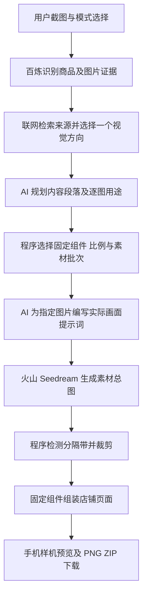

# 店铺装修推荐项目目标与架构交接

更新日期：2026-10-16。面向接手开发、排障或方案讨论的 agent。

## 本次同步：裁剪版珠宝 v9

- 5184 的新建珠宝任务已同步逐图分支的 v9 规划方法：先确定各图可见信息，再设计场景与构图；全套共享色彩、反差和质感，不固定为同一背景与光位。仍根据完整识别资料理解经营方向，允许创作范围内的新款式，不锁原 SKU。
- 方法来源为 `oldred-byte/ec-visual-skill` 的 [visual-dna](https://github.com/oldred-byte/ec-visual-skill/blob/main/references/visual-dna.md) 和 [message-picture-patterns](https://github.com/oldred-byte/ec-visual-skill/blob/main/references/message-picture-patterns.md)。总图请求仅保留本批逐格描述、共享视觉语言与必要分格规格，不再叠加整页叙事及全部专业规则。
- 原素材数量、批次、行列比例、洋红分隔带、裁剪、组装、下载及模型调用方式保持原路径。仅新建珠宝任务使用 v9；已保存的任务、通用、数码和鞋履规则不升级。5185 逐图分支本轮未修改。
- 仅作修改文件的语法与差异检查，没有生图或模拟测试，视觉效果交给用户验收。下文 v8 描述保留为历史背景。

裁剪修复记录：任务 `55daa2cf-1eec-4b15-9cf2-80463b359196` 的已保存总图具有3行5格，但分隔带约为 RGB(213, 1, 111)，且缺少完整外框，标准洋红检测及原外框校准无法识别。`crop.cjs` 在原行检测失败时补充窄幅、贯穿全宽的内部分隔带校准；要求横带数及检测出的全部行列数符合方案，只将与图像外围连通的匹配颜色作为分隔，避免内部宝石被当作分隔带。不按预计比例猜切，不改生图或自动重试。用户可通过“继续未完成素材”复用已保存总图；本轮未执行裁剪恢复、生图或模拟测试。

本项目帮助不懂店铺装修的用户，把商品截图转成一套可预览、可下载的店铺装修方案。当前主线采用 **AI 理解商品与设计图片，程序选择固定组件、裁剪图片并组装页面** 的分工。新珠宝 v8 任务向后续 AI 传递完整识别资料，由 AI 判断实际经营商品类型并创作新款式，不要求复刻原 SKU；其他模式与旧任务沿用原规则。

## 当前工作位置

| 项目 | 当前约定 |
| --- | --- |
| 实际开发与运行的工作副本 | `H:\Codex\jewelry-still-life\店铺装修推荐` |
| 当前分支 | `codex/jewelry-still-life` |
| 主线代码目录 | `experiments/store-decoration/planning/`，下文简称 `planning/` |
| 本机页面 | `http://127.0.0.1:5184/` |
| 本机任务目录 | `planning/output/runs/<任务ID>/` |

会话的默认目录可能显示为 `H:\店铺装修推荐`，但近期修改和 5184 服务使用的是上表中的工作副本。动手前先核对工作目录和分支。当前副本已有未提交的功能修改，不要重置、覆盖或误当作本轮新增变更。

仓库同时保留早期应用和多轮实验。根目录的 Vinext/React 工程、`server/`、`scripts/decoration-assisted/` 及历史验证脚本不是当前 5184 页面入口。根 README 中部分“当前版本”“尚未实现”等文字属于当时的历史记录，不能直接作为当前功能判断。

## 产品目标与已确认边界

- 用户上传 1 至 6 张商品图片或商品列表截图，选择通用、珠宝、数码或鞋履模式，一轮得到一套方案，不要求比较多个候选风格。
- 展示清楚的整店效果，同时提供完整 PNG 长图和可按模块取用的素材 ZIP。ZIP 用于手动装修，不是平台一键导入包，也没有自动发布能力。
- 珠宝 v8 保留识别出的商品描述、来源与不确定信息，由 AI 判断哪些特征代表经营方向，允许在这个范围内设计新款式。v5–v7 的“只传大类名”仅保留给旧任务；不静默升级旧任务或改变其他模式。
- 固定组件承载店招、导航、海报、轮播、橱窗与文字。生图模型只画素材，不画网页控件、价格、标题或平台 UI。
- 不虚构经营品类、真实商品材料、品牌、销量、认证或功能；示意外观属于设计选择，识别中的视觉描述及推测也不是材质、价值或定位证明。信息不足与模式适用性是两回事：保留原有信息充足性判断，不增加品类白名单或专业模式准入判断。

当前珠宝质量目标是：生成商品仍符合实际经营方向，一个有明确构思的主视觉，整套协调且有强弱变化，完整覆盖经营品类。上传图用于理解商品类型，不要求逐件复刻原款。流程完成不能直接证明这些视觉目标已经达到。

## 主流程与职责边界



一次正常任务包含五次语言或视觉模型请求：商品识别、联网检索、风格选择、内容规划、逐图设计。生图最多两批，每批生成一张含多个独立画面的总图；不要求用满预算。

**AI 决定内容，程序决定几何。** AI 先说明展示哪些商品、各图用途与主次；程序据此选择现有组件、绑定素材编号、确定比例及分格。后续逐图设计只能填写指定图片的描述、镜头与表现方式，不能自行增删组件或图片。

**检索来源不等于已看过官网图片。** 当前风格阶段取得的是服务返回的来源标题与网址，没有自动阅读网页正文或案例原图。专业化案例规则来自先前人工视觉分析，不能宣称模型已经理解了所有官网设计。

**珠宝 v8 恢复完整识别信息的传递。** 搜索、风格、内容与逐图设计收到保存的识别资料，商品描述、来源及不确定信息不再被压缩成大类名。`product-*` 引用识别商品，沿用已有描述与来源字段；AI 在现有请求内决定经营类型及创作边界，不新增摘要阶段。逐图设计仍不附原图，火山生图仍收到最终提示词及可选的上一批总图。v5–v7 旧任务保留品类输入；v1–v4 与其他模式保留各自原有路径。本轮不新增商品锁定、母版生成或视觉评分。

## 架构导航

`planning/` 是独立的 Node.js CommonJS 应用，前端是单个 HTML 工作台，使用原生 HTTP 服务与本地文件持久化。它有自己的 `package.json`，不要用根应用的启动和构建流程代替。

| 位置 | 主要职责 |
| --- | --- |
| `planning/index.html` | 上传、模式选择、任务进度、失败恢复、提示词查看、预览与下载。手机框仅是预览外壳，不进入导出长图。 |
| `planning/server.cjs` | HTTP 入口、任务创建、并发保护、状态读写、继续任务、手动上传与导出接口。 |
| `planning/product-workflow.cjs` | 串联识别、检索、风格、内容、逐图设计、生图及组装；复用已保存阶段结果。 |
| `planning/visual-profile.cjs` | 通用流程上的珠宝、数码、鞋履规则与版本快照，包含各阶段的设计要求。 |
| `planning/content-plan.cjs` | 内容提纲与品类覆盖约束；把提纲编译为固定模块、图片任务和批次。珠宝 v8 携带商品描述与来源供 AI 判断经营类型，v5–v7 保留品类引用，v4 保留原商品证据约束；v5 以来沿用实际显示尺寸。 |
| `planning/model-contracts.cjs`、`planning/plan.cjs` | 校验模型响应与完整方案，守住图片编号、用途、组件参数和预算；拼装最终素材总图提示词。 |
| `planning/catalog.cjs`、`a9-component-library/lib/` | 固定组件目录、槽位尺寸及 HTML/CSS 渲染。`a9-component-library/` 与 `planning/` 同级。 |
| `planning/qwen-provider.cjs` | 百炼识别和规划、联网搜索、JSON 解析、调用记录；还提供图片恢复等共享辅助逻辑。 |
| `planning/ark-image-provider.cjs` | 当前主线实际使用的火山生图适配器。不能因其他文件保留图片函数就误换供应商。 |
| `planning/crop.cjs`、`planning/compose.cjs` | 检测总图边界、处理裁剪与有限留边、填入固定组件，输出页面与素材绑定。 |
| `planning/stage-cache.cjs`、`planning/download.cjs` | 前者复用有效阶段；后者导出完整长图、素材 ZIP 和离线预览。 |
| `planning/navigation-library.cjs`、`planning/structure*.cjs`、示例文件 | 已有导航图库、手填结构和离线示例等保留入口；不是专业模式准入系统。 |

历史目录 `a8-*` 至 `a13-*` 保存早期长页、组件验证、总图裁剪及完整示例。其中组件库仍被主线依赖，其他历史演示不应随日常修复改写。

## 专业模式如何扩展

通用、珠宝、数码与鞋履共用同一条处理链。专业模式通过 `visual-profile.cjs` 提供识别、风格、内容和逐图设计规则，不各建一套后端或页面。

模式由用户选择。数码不限于已有案例中的手机，鞋履不限于案例鞋型；没有对应案例可以影响质量预期，但不应阻止用户使用。案例用于提炼设计方法，不是允许生成的商品清单。

每个新任务保存自己的模式和规则版本。已有任务继续时沿用保存的视觉方案，不因规则更新被静默替换。旧珠宝任务曾有适用性识别门槛，现已移除；不要恢复 `modeAssessment` 拦截。

截至本次交接，新珠宝规则为 v8，数码与鞋履仍为 v1。当前交付边界：

1. 完整识别资料传给后续 AI，`product-*` 引用实际商品资料，用于理解经营类型而非锁定原 SKU；原有响应字段结构与品类覆盖校验保留。程序不新增特征分类器或款式白名单。
2. 主视觉固定现有 `carousel.medium`（4:3），只设计一个主题和主要焦点。
3. 相邻单图内容段合为双列，保留素材编号、品类、逐图用途和衔接文字；三图用现有组合组件，不增删素材。逐图设计收到实际显示尺寸。
4. 不新增三品类导航、细节段专门逻辑、字体或间距改造、动效、视觉评分、自动重试或额外生图步骤。仍最多12张素材、两批。
5. 只做必要静态检查；生图与视觉验收交给用户。旧任务使用保存的 v1–v7 规则及对应数据路径，不能通过“继续”获得 v8 效果。

v6 仅细化视觉规划与最终提示词：风格阶段从已有人工案例摘要中说明要借鉴的构图方法，并把色彩分工、明确光向与软硬、背景材质关系写入现有 `style` 和三条 `anchors`；逐图设计沿用这些约定，明确主体位置、占比、承托、留白与展示任务。最终生图提示词对 v6 使用“共用光色优先、逐图构图变化”的规则，v1–v5 的原优先级保留。没有增加字段、模型调用、候选图、视觉评分或重试，上传原图仍只供识别品类。依据既有任务 a294e509 的文字记录可见重复悬浮/支架及光向描述变化；这不是图片质量实测，v6 的实际视觉收益仍待用户验收。

这些是模型的设计要求，不是视觉质量已被程序保证。新增品类应优先沿用现有模式机制；不能把扩品类变成重写流程或增加未确认的筛选逻辑。

v7 针对任务 `dbbe50ef-ba07-4964-ab5d-a1c4db578a69` 的画面近似问题：只读核对确认四张素材各使用一次、裁剪区域不同，但手镯与戒指都被规划为直立素圆环，主视觉和末图也重复弯曲项链组合。仅调整珠宝规则中的内容规划、逐图设计与贯穿生图的要求：并排小图以清楚轮廓或组合差别为基础，再区分构图；正文必须提供主视觉之外的信息，不以小幅角度、占比变化或增减配角替代新画面。保持共用光色、上传图只参考品类和原有全部调用及组件流程，不增加字段、自动相似度检查、拦截或重试。新规则仅用于新建珠宝任务；本轮未生图或模拟测试，效果由用户验收。

v8 针对任务 `6d657d1c-dcef-46e1-9517-e58a57a4857f` 的经营商品方向偏移：原图及识别描述包含彩色石状装饰、镶嵌与具象造型，但程序在规划前只保留项链、手镯、戒指大类，方案遂转为金属弧线和素款。修复 `planningRecognition` 与 `evidenceFor` 的信息传递，并为 v8 同步调整各阶段提示词；AI 根据原有识别资料理解商品类型，在现有 `reason`、`subject`、`prompt` 中落实设计，不增加模型响应字段、调用或程序语义判定。保留版式、光色统一和画面差异要求，但不能靠改换经营类型制造差异。本轮仅静态检查，实际生成结果由用户用同一组图片验收，不能声称已经验证视觉收益。

v8 后续修复任务 `b1629bc9-8598-4cfe-a2c8-79c55549c60e` 的品类覆盖口径：项链已在 `heroSubject` 中安排，但旧校验只统计正文引用，因此失败于内容规划，尚未生图。珠宝 v8 内容请求现在要求 `heroEvidenceIds`，程序验证编号后合计主视觉与正文覆盖，并将首图所引商品资料传入逐图设计；不从自然语言猜测品类，也不自动补图。旧 v8 任务继续时补充同一覆盖口径，保留保存的视觉方向；没有首图引用的历史规划仍按原正文覆盖检查，若不能通过，由用户点击继续后从内容规划重新请求，不篡改已保存响应或自动调用。其他模式与 v1–v7 的内容约定不变。仅做必要静态检查，未生图或模拟测试。

## 任务持久化与排障入口

所有阶段记录位于实际输出目录的 `<任务ID>/` 下。`/?run=<任务ID>` 用于重新打开已有任务，不会仅因打开页面就重新提交生图。

| 文件或文件组 | 能回答的问题 |
| --- | --- |
| `state.json` | 当前状态、失败阶段、已填素材、规则版本和调用计数。`ready` 可能仍有缺图，须结合 `workflow`、错误及素材数量看。 |
| `input-*.jpg`、`recognition.json` | 用户实际提供了什么，识别是否准确，商品来自哪张图。 |
| `search-sources.json`、`style-research.json` | 搜索实际取得哪些来源，最终采用什么视觉方向。 |
| `content-plan.json`、`structure-plan.json`、`plan.json` | 分别对应内容提纲、程序编译的布局、填入逐图设计的最终方案。失败时后续文件可能尚未存在。 |
| 各阶段的 `*-input.json`、`*-instructions.txt`、`*-response.txt`、`*-call.json` | 实际输入、提示要求、模型原文、结束原因及调用记录；多次尝试带 `attempt-*`。 |
| `generation-batches.json`、`structure-*-prompt.txt`、`structure-*-source.png` | 实际批次、最终生图提示词与收到的原总图。 |
| `assets/`、`*-crop-report.json`、`page.json`、`layout.json`、`shop.html` | 裁剪后的素材、裁剪记录、固定页面结构与实际预览；裁剪记录还汇总在任务状态中。 |

排障从用户给出的任务 ID 和错误阶段开始，只读对应记录，先区分识别、内容规划、逐图设计、生图接口、下载或裁剪的问题，不要重新跑全流程来猜原因。

- 规划失败可用“沿用已有资料继续”，复用有效识别、来源、风格与内容结果；画面设计缓存还核对结构签名。
- 继续未完成素材时优先复用已经取得的总图。只有需要补做的模型阶段才发起请求；“继续”按钮不是只读操作，agent 不得代用户点击来验证修复。
- 已成功批次保留，不因其他批次失败重做。下载失败不等于生图失败。
- 服务重启会将未完成任务标记为中断，不自动重新调用。重启前先确认没有正在执行的任务。
- 响应校验不能替代视觉验收，也不能为了绕过报错静默丢弃商品、猜测证据编号或把缺失内容伪造成成功。

## 模型配置与本机启动

识别与设计使用百炼，当前默认视觉规划模型为 `qwen3.5-plus`，检索模型为 `qwen-plus`。生图使用火山引擎的 `doubao-seedream-5-0-pro-260628`，代码对该型号作了明确限制，不允许静默改成其他图片模型。

正常独立配置读取仓库根目录 `.env.local`。本机当前工作副本复用了另一个工作副本的配置和依赖，下面是最近使用的启动方式；它只启动服务，模型调用由用户提交任务触发。先确认 5184 没有已有服务，无需为了阅读文档、修改提示词而重新安装依赖。

```powershell
Set-Location 'H:\Codex\jewelry-still-life\店铺装修推荐\experiments\store-decoration\planning'
$env:PLANNER_PORT='5184'
$env:PLANNER_OUTPUT_DIR='H:\Codex\jewelry-still-life\店铺装修推荐\experiments\store-decoration\planning\output\runs'
$env:NODE_PATH='H:\Codex\store-planning-workflow\店铺装修推荐\experiments\store-decoration\planning\node_modules'
& 'C:\Users\Administrator\AppData\Local\hermes\node\node.exe' --env-file='H:\Codex\store-planning-workflow\店铺装修推荐\.env.local' server.cjs
```

上述路径是本机配置，不是可移植依赖声明。换机器时按 `planning/package.json` 与对应锁文件准备依赖和本机密钥。不要输出、复制进文档或提交密钥；任务输出、原始图片、环境文件与依赖目录默认不进 Git。

## 当前进展与接手约束

商品截图到装修预览、专业模式选择、手机样机外框、PNG/ZIP 下载及失败恢复均已实现。流程上限为 24 个模块、12 张独立素材、2 批总图，每批最多 6 格；这些是上限，不是生成目标。输入最多 6 张、单张 10MB、合计 30MB；原有信息判断要求至少两种可辨识商品或款式，单一经营品类也有效。

最近一次修复针对“画面设计模型返回 JSON Schema 而没有返回实际设计”：设计请求改为要求填好的 `artDirection` 与 `assets`，列出实际图片编号，并单独识别这种异常。素材完整性检查、旧任务恢复和不自动重试的行为保留。

本机任务 `779ee3e7-ebea-4614-8011-95678021aefe` 在 2026-10-16 读取时为 `ready / complete`，6 张素材全部填入，记录 1 次生图调用。它可用于定位最近一次修复后的任务资料；这只说明该任务已完成组装，不代表用户已验收视觉效果或其他品类已全面验证。

用户长期要求如下，最新明确指令优先：

1. **生图验证交给用户。** 不自行调用真实模型、生图接口、付费重试或用“继续任务”验证。近期修复同样禁止模拟测试；只做与改动直接相关、用户允许的必要静态检查，不扩大测试范围。
2. **修改只围绕当前问题。** 发现会影响已有功能或发生代码、功能冲突时，立即停止并告知；不得借机重构、换模型或更改交互方向。
3. **尊重既有授权与资料。** 先核对本会话、相关任务记录和已知路径，不让用户重复提供已给出的信息。文档中的方向和待完善点不等于继续开发授权。
4. **推送单独按用户要求处理。** 使用 `github-push` 技能，只提交到要求的分支；没有新授权不合并、不发布，不把普通修复扩成仓库整理。多步骤开发和排障沿用 `execution-scope` 技能。
5. **以事实讨论效果。** 用户希望通过项目练习判断，不希望 agent 一味附和。区分已观察到的结果、机制推测和待验证的改进；用户明确要求直接执行时不要追加问卷或练习。

接手时先读本文，再按任务阅读 `product-workflow.cjs`、相关专业规则及对应模块；需要接口、导出或裁剪细节时再查 `planning/README.md`。历史文档中的测试命令不是本轮测试授权。保持当前“固定组件＋专业化视觉规则＋用户验收”的方向，不因看到旧工程而另起实现路径。
